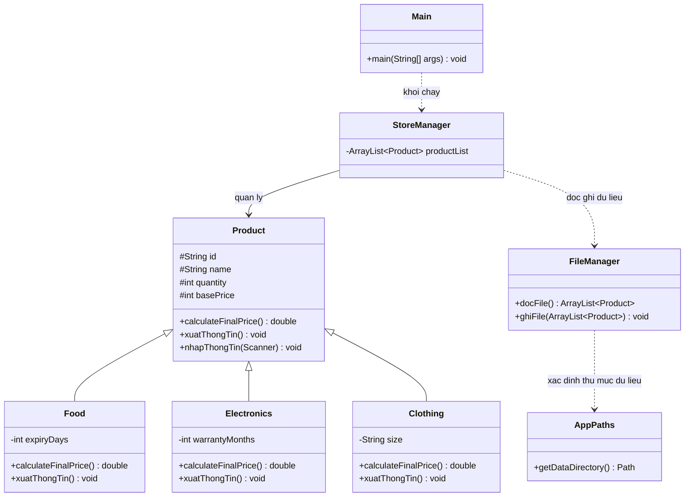
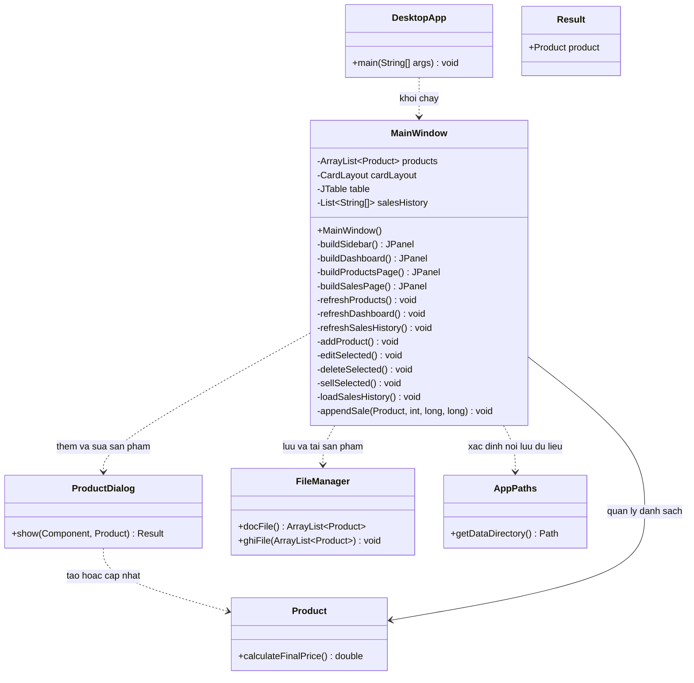

# ĐỒ ÁN LẬP TRÌNH HƯỚNG ĐỐI TƯỢNG
## QUẢN LÝ CỬA HÀNG BÁN LẺ

Ứng dụng quản lý cửa hàng bán lẻ được xây dựng bằng **Java**, áp dụng các nguyên lý **lập trình hướng đối tượng (OOP)** nhằm hỗ trợ quản lý sản phẩm, theo dõi số lượng tồn kho và ghi nhận hoạt động bán hàng.
Dự án gồm phiên bản giao diện dòng lệnh và phiên bản ứng dụng desktop sử dụng **Java Swing** cùng thư viện **FlatLaf**, giúp người dùng thao tác trực quan và thuận tiện hơn.

## Giới thiệu đồ án

Mục tiêu của đồ án là vận dụng kiến thức lập trình hướng đối tượng vào việc xây dựng một chương trình quản lý cửa hàng bán lẻ. Thông qua dự án, nhóm thực hành thiết kế lớp, tổ chức dữ liệu, xử lý nghiệp vụ và xây dựng giao diện người dùng.
Ứng dụng hỗ trợ quản lý nhiều nhóm sản phẩm khác nhau, mỗi nhóm có các thuộc tính và quy tắc tính giá riêng.

## Chức năng chính

- **Quản lý sản phẩm:** Thêm, chỉnh sửa, xóa và theo dõi danh sách sản phẩm.
- **Phân loại sản phẩm:** Hỗ trợ các nhóm Thực phẩm, Đồ điện tử và Quần áo.
- **Quản lý tồn kho:** Theo dõi số lượng sản phẩm và cập nhật số lượng khi bán hàng.
- **Tính giá bán tự động:** Áp dụng quy tắc tính giá riêng cho từng loại sản phẩm.
- **Xử lý dữ liệu đầu vào:** Kiểm tra dữ liệu nhập, hạn chế lỗi sai kiểu dữ liệu và số lượng không hợp lệ.
- **Lưu trữ dữ liệu:** Đọc và ghi dữ liệu sản phẩm để sử dụng lại khi mở chương trình.
- **Giao diện desktop:** Cung cấp các trang tổng quan, quản lý sản phẩm và bán hàng.

## Chức năng bổ sung trên nhánh phát triển

- **Nhập kho:** Cộng số lượng nhập vào tồn kho, lưu ngày nhập gần nhất và ghi lịch sử nhập kho kèm nhà cung cấp (nếu có).
- **Lịch sử nhập kho:** Xem lại các lần nhập theo thời gian, mã/tên sản phẩm, số lượng và nhà cung cấp; có thể sắp xếp bảng.
- **Thống kê cửa hàng:** Tổng hợp số loại sản phẩm, tồn kho, mặt hàng sắp hết/hết hàng, giá trị tồn theo giá bán, số lượng đã bán và doanh thu ghi nhận.
- **Xuất hóa đơn PDF:** Xuất hóa đơn cho giao dịch đã chọn trong lịch sử bán hàng.
- **Ngày nhập hàng:** Hiển thị ngày nhập gần nhất trong danh sách sản phẩm.
- **Kiểm tra tự động:** GitHub Actions chạy `mvn clean package` với Java 17 khi cập nhật nhánh phát triển hoặc mở pull request vào `main`.

## Công nghệ sử dụng

| Công nghệ | Mục đích |
|---|---|
| Java | Ngôn ngữ lập trình chính |
| OOP | Tổ chức chương trình theo hướng đối tượng |
| Java Swing | Xây dựng giao diện desktop |
| FlatLaf | Tùy chỉnh giao diện ứng dụng Java Swing |
| Maven | Quản lý thư viện và cấu hình dự án |
| GitHub Actions | Tự động xây dựng bản ứng dụng Windows |

## Các nguyên lý lập trình hướng đối tượng

1. **Đóng gói (Encapsulation):** Kiểm soát quyền truy cập dữ liệu và thao tác thông qua các phương thức của lớp.
2. **Kế thừa (Inheritance):** Các lớp `Food`, `Electronics` và `Clothing` kế thừa từ lớp `Product`.
3. **Đa hình (Polymorphism):** Các lớp sản phẩm triển khai cách tính giá và hiển thị thông tin phù hợp với từng loại.
4. **Trừu tượng (Abstraction):** Lớp `Product` định nghĩa khuôn mẫu chung cho các nhóm sản phẩm.

## Thông tin sinh viên

**Sinh viên thực hiện:**

| STT | Họ và tên | Mã sinh viên |
|---:|---|---|
| 1 | Nguyễn Thị Thanh Vy | NBS2503ITA0015 |
| 2 | Huỳnh Sĩ An Khang | NBS2503ITA0007 |
| 3 | Đỗ Quan Đạt | NBS2603ITA0012 |
| 4 | Nguyễn Hoàng Hữu Đức | NBS2503ITA0012 |

**Ngôn ngữ phát triển:** Java

---
  
## Sơ đồ UML

### 1. Sơ đồ lớp nghiệp vụ

----------

### 2. Sơ đồ lớp giao diện desktop

